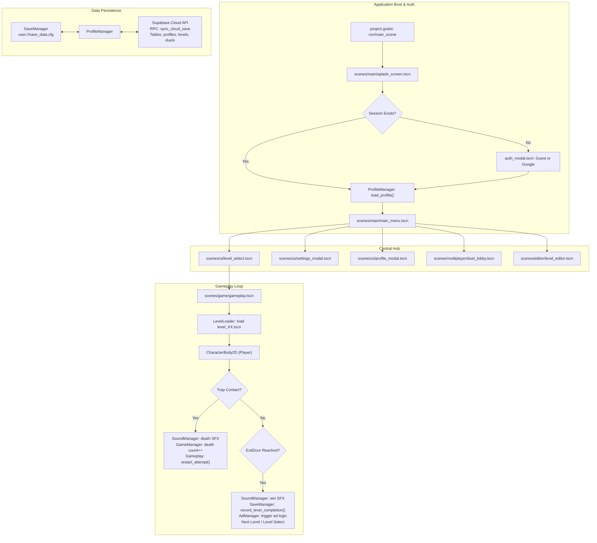

# WRONG WAY — PHASE 1: COMPLETE PROJECT INVENTORY & ARCHITECTURE MAP

**Audit Phase:** 01 — Project Inventory  
**Status:** COMPLETED  
**Auditor:** Forensic Game Engineering Team  
**Verification Method:** Static Code Analysis, Godot 4.7.2 Headless Parser, Node.js File System Inspection  

---

## 1. EXECUTIVE METRICS & INVENTORY SUMMARY

| Category | Count | Status | Notes |
| :--- | :--- | :--- | :--- |
| **Total Non-Ignored Files** | 1,188 | Verified | Excludes `.git`, `.godot`, `build`, and `audit` |
| **Project Core Files** | 435 | Verified | Core game assets, scripts, scenes, and configs |
| **External Addon Files** | 753 | Verified | Located in `addons/admob` (Poing Godot AdMob Next-Gen) |
| **GDScript Source Files (.gd)** | 238 | Verified | 81 Project Scripts, 157 Addon Scripts |
| **Godot Scene Files (.tscn)** | 123 | Verified | 105 Project Scenes, 18 Addon Sample Scenes |
| **Godot Resource Files (.tres, .res)** | 30 | Verified | Button styles, theme overrides, audio buses |
| **Shaders (.gdshader)** | 2 | Verified | Blur background, color tint |
| **Audio Streams (.wav, .ogg)** | 2 | Verified | 1 Ambient WAV (17.5 MB), 1 OGG music track |
| **Images & Icons (.png, .svg, .jpg)** | 77 | Verified | UI icons, backgrounds, avatars, splash screen |
| **Typography (.otf)** | 1 | Verified | `assets/fonts/Inter-VariableFont_opsz,wght.otf` |
| **Project Configurations (.godot, .cfg)** | 11 | Verified | `project.godot`, `export_presets.cfg`, etc. |
| **Autoload Singletons** | 12 | Verified | Registered in `project.godot` under `[autoload]` |
| **Game Levels Authored** | 60 | Verified | `level_01.tscn` through `level_60.tscn` |
| **Total Extracted Functions** | 689 | Verified | Across 81 project GDScript files |

---

## 2. PROJECT DIRECTORY STRUCTURE

```
d:/Documents/wrong-way/
├── .editorconfig                     # Code indentation and whitespace formatting
├── .env                              # Supabase URL & Anon Key local environment
├── .gitattributes                    # Git LFS & line ending definitions
├── .gitignore                        # Git exclusion rules
├── export_presets.cfg                # Android & Web export configurations
├── project.godot                     # Godot 4 Engine project definition
├── project_code.txt                  # Full codebase consolidated dump (58,250 lines)
├── addons/                           # External plugins
│   └── admob/                        # Poing Godot AdMob Next-Gen plugin (v1.4.0)
│       ├── android/                  # Android AARs, export plugin, mediation adapters
│       ├── gdscript/                 # High-level AdMob API (MobileAds, RewardedAdLoader)
│       ├── ios/                      # iOS frameworks and adapters
│       └── skills/                   # Plugin reference documentation
├── assets/                           # Raw multimedia assets
│   ├── audio/                        # Sound effects & BGM (bgm_ambient.wav)
│   ├── fonts/                        # TrueType / OpenType font definitions
│   └── images/                       # UI backdrops, avatars, SVG source graphics
├── data/                             # Game data storage
│   └── levels_60.json                # JSON dump of authored levels
├── docs/                             # Project developer documentation
├── resources/                        # Godot theme styles & materials
│   └── themes/                       # Button states (glass, capsule, obsidian)
├── scenes/                           # Compiled Godot scenes
│   ├── editor/                       # In-game level editor scene
│   ├── game/                         # Active gameplay runner & camera rig
│   ├── levels/                       # 60 authored level scenes (level_01 - level_60)
│   ├── main/                         # Splash screen & main menu entry
│   ├── multiplayer/                  # Duel lobby, match invite & scoreboard
│   ├── objects/                      # Exit doors, platforms, backdrop visualizers
│   ├── player/                       # CharacterBody2D player rig & ghost effects
│   ├── tools/                        # Diagnostic camera tester
│   ├── traps/                        # 20 distinct trap prefab scenes
│   └── ui/                           # HUD, level select, modals, settings
├── scripts/                          # GDScript source implementations
│   ├── core/                         # Singletons, save system, locale, auth
│   ├── editor/                       # Custom level editor controller & storage
│   ├── levels/                       # Gameplay camera framing & level loader
│   ├── multiplayer/                  # Real-time duel backend RPC sync
│   ├── objects/                      # Exit door trigger, platform behaviors
│   ├── platforms/                    # Moving platform mechanics
│   ├── player/                       # Movement physics, jump, dash, collision
│   ├── systems/                      # Level progression coordinator (orphan)
│   ├── tools/                        # In-engine level validator
│   ├── traps/                        # 22 individual trap controllers
│   └── ui/                           # Viewport responsive layouts, menus, HUD
├── shaders/                          # Visual enhancement shaders
├── tests/                            # Automated test suites & test runners
└── tools/                            # Developer conversion scripts & utilities
```

---

## 3. AUTOLOAD SINGLETON SERVICES INVENTORY

Registered under `[autoload]` in [project.godot](file:///d:/Documents/wrong-way/project.godot):

| Singleton Name | Target Script | Scope & Core Responsibility |
| :--- | :--- | :--- |
| **`SaveManager`** | `res://scripts/core/save_manager.gd` | Persistent disk I/O (`user://save_data.cfg`), progress, star tallies, best times, settings. |
| **`LocaleManager`** | `res://scripts/core/locale_manager.gd` | Multilingual localization (Uzbek, English, Russian), font remapping. |
| **`IconFactory`** | `res://scripts/core/icon_factory.gd` | Dynamic SVG vector generation for procedural UI elements without bloated PNGs. |
| **`SoundManager`** | `res://scripts/core/sound_manager.gd` | Procedural synthesizer + audio bus manager (jump, click, death, win SFX, ambient BGM). |
| **`GameManager`** | `res://scripts/core/game_manager.gd` | Match state, countdown sequence (`is_countdown_active`), global pause state. |
| **`AdManager`** | `res://scripts/core/ad_manager.gd` | Google AdMob banner/interstitial/rewarded coordinator (contains mock fallback UI). |
| **`CustomLevelManager`**| `res://scripts/editor/custom_level_manager.gd` | User-authored custom level disk storage (`user://custom_levels/`). |
| **`SaveSystem`** | `res://scripts/core/save_manager.gd` | Legacy alias pointing directly to `SaveManager` for backward compatibility. |
| **`LevelDatabase`** | `res://scripts/core/level_database.gd` | Holds 60 hardcoded levels in memory; syncs authored levels from Supabase `levels` table. |
| **`ProfileManager`** | `res://scripts/core/profile_manager.gd` | Player identity, tag (`WW-XXXX`), guest/Google auth, Supabase `profiles` cloud sync. |
| **`DuelService`** | `res://scripts/multiplayer/duel_service.gd` | Real-time duel matchmaker, challenge invitation polling, match completion sync. |
| **`GoogleAuthService`** | `res://scripts/core/google_auth_service.gd` | Android Google Sign-In SDK hook (`GodotGoogleSignIn`) and web fallback. |

---

## 4. DETAILED PROJECT SCRIPTS INVENTORY (81 SCRIPTS)

### 4.1 Core System Scripts (`scripts/core/`)
1. [save_manager.gd](file:///d:/Documents/wrong-way/scripts/core/save_manager.gd) (364 lines) — `SaveManager`
2. [game_manager.gd](file:///d:/Documents/wrong-way/scripts/core/game_manager.gd) (105 lines) — `GameManager`
3. [ad_manager.gd](file:///d:/Documents/wrong-way/scripts/core/ad_manager.gd) (566 lines) — `AdManager`
4. [profile_manager.gd](file:///d:/Documents/wrong-way/scripts/core/profile_manager.gd) (440 lines) — `ProfileManager`
5. [level_database.gd](file:///d:/Documents/wrong-way/scripts/core/level_database.gd) (3,283 lines) — `LevelDatabase`
6. [sound_manager.gd](file:///d:/Documents/wrong-way/scripts/core/sound_manager.gd) (274 lines) — `SoundManager`
7. [icon_factory.gd](file:///d:/Documents/wrong-way/scripts/core/icon_factory.gd) (705 lines) — `IconFactory`
8. [locale_manager.gd](file:///d:/Documents/wrong-way/scripts/core/locale_manager.gd) (165 lines) — `LocaleManager`
9. [google_auth_service.gd](file:///d:/Documents/wrong-way/scripts/core/google_auth_service.gd) (240 lines) — `GoogleAuthService`
10. [env.gd](file:///d:/Documents/wrong-way/scripts/core/env.gd) (49 lines) — `Env`
11. [ui_responsive.gd](file:///d:/Documents/wrong-way/scripts/core/ui_responsive.gd) (74 lines) — `UIResponsive`
12. [game_app.gd](file:///d:/Documents/wrong-way/scripts/core/game_app.gd) (33 lines) — **DEAD CODE** (Never instantiated)

### 4.2 UI & Viewport Scripts (`scripts/ui/`)
1. [splash_screen.gd](file:///d:/Documents/wrong-way/scripts/ui/splash_screen.gd) (234 lines) — Main entry point & auth flow
2. [main_menu.gd](file:///d:/Documents/wrong-way/scripts/ui/main_menu.gd) (185 lines) — Main dashboard navigation
3. [level_select.gd](file:///d:/Documents/wrong-way/scripts/ui/level_select.gd) (245 lines) — 3-Chapter grid selector (60 levels)
4. [game_hud.gd](file:///d:/Documents/wrong-way/scripts/ui/game_hud.gd) (320 lines) — On-screen mobile touch controls & timer
5. [pause_menu.gd](file:///d:/Documents/wrong-way/scripts/ui/pause_menu.gd) (110 lines) — In-game pause overlay
6. [settings_modal.gd](file:///d:/Documents/wrong-way/scripts/ui/settings_modal.gd) (260 lines) — Audio, language & touch settings
7. [auth_modal.gd](file:///d:/Documents/wrong-way/scripts/ui/auth_modal.gd) (180 lines) — Guest vs Google sign-in modal
8. [profile_modal.gd](file:///d:/Documents/wrong-way/scripts/ui/profile_modal.gd) (195 lines) — Player card, avatar picker, stats
9. [control_customizer.gd](file:///d:/Documents/wrong-way/scripts/ui/control_customizer.gd) (150 lines) — Drag-and-drop touch layout editor
10. [atmospheric_backdrop.gd](file:///d:/Documents/wrong-way/scripts/ui/atmospheric_backdrop.gd) (85 lines) — Dynamic gradient backdrop
11. [cloud_layer.gd](file:///d:/Documents/wrong-way/scripts/ui/cloud_layer.gd) (65 lines) — **DEAD CODE** (Never instantiated)
12. [home_menu.gd](file:///d:/Documents/wrong-way/scripts/ui/home_menu.gd) (73 lines) — **DEAD CODE** (Old prototype with broken paths)
13. [title_screen.gd](file:///d:/Documents/wrong-way/scripts/ui/title_screen.gd) (28 lines) — **DEAD CODE** (Old prototype with broken paths)
14. [main_menu_controller.gd](file:///d:/Documents/wrong-way/scripts/ui/main_menu_controller.gd) (25 lines) — **DEAD CODE** (Old prototype)

### 4.3 Player & Physics Scripts (`scripts/player/`)
1. [player_controller.gd](file:///d:/Documents/wrong-way/scripts/player/player_controller.gd) (237 lines) — Movement, variable jump, dash, raycasts
2. [player_dash_ghost.gd](file:///d:/Documents/wrong-way/scripts/player/player_dash_ghost.gd) (42 lines) — Motion trail afterimage
3. [player_spawner.gd](file:///d:/Documents/wrong-way/scripts/player/player_spawner.gd) (55 lines) — Spawn point and respawn cycle

### 4.4 Trap Mechanisms (`scripts/traps/` - 22 Scripts)
1. `spikes.gd` (Area2D instant lethal hazard)
2. `pop_up_spikes.gd` (Proximity-triggered rising spikes)
3. `moving_saw.gd` (Linear back-and-forth lethal saw)
4. `circular_saw.gd` (Static/orbiting rotary lethal blade)
5. `falling_spike.gd` (Gravity-triggered ceiling stalactite)
6. `crusher.gd` (Overhead crushing block with downward smash)
7. `laser_beam.gd` (Pulsing or continuous laser tripwire)
8. `spring.gd` (Upward / directional impulse launch pad)
9. `rolling_boulder.gd` (Physics-based rolling rock hazard)
10. `fake_door.gd` (Deceptive exit door that triggers lethal spikes)
11. `trap_floor.gd` (Collapsing / dissolving ground platform)
12. `crumbling_platform.gd` (Static platform that breaks on contact)
13. `crashing_pillar.gd` (Horizontal or vertical moving barrier)
14. `dodging_platform.gd` (Troll platform that moves away when jumped toward)
15. `invisible_block.gd` (Hidden collision block revealed on head-bonk)
16. `jumping_spikes.gd` (Spikes that jump upward when player is airborne)
17. `rotating_spike_ball.gd` (Pendulum / chain-linked rotating hazard)
18. `sinking_door_floor.gd` (Floor that lowers the goal door into a pit)
19. `control_inverter.gd` (Hazard zone that inverts Left/Right inputs)
20. `falling_ceiling.gd` (Ceiling that drops to crush entire corridor)
21. `trap_base.gd` (45 lines) — **DEAD CODE** (Unused base class, no traps extend it)
22. `crusher_visuals.gd` (38 lines) — **DEAD CODE** (Unreferenced visual helper)

### 4.5 Gameplay & Level Management (`scripts/levels/`)
1. [gameplay.gd](file:///d:/Documents/wrong-way/scripts/levels/gameplay.gd) (315 lines) — Level runner, death/win events, camera zoom-to-fit
2. [camera_controller.gd](file:///d:/Documents/wrong-way/scripts/levels/camera_controller.gd) (120 lines) — Dynamic Camera2D zoom & boundary clamp
3. [level_loader.gd](file:///d:/Documents/wrong-way/scripts/levels/level_loader.gd) (145 lines) — Instantiates `level_%02d.tscn` from disk or DB
4. [level_transition.gd](file:///d:/Documents/wrong-way/scripts/levels/level_transition.gd) (60 lines) — Fade-to-black tween transition

### 4.6 Multiplayer & Duels (`scripts/multiplayer/`)
1. [duel_service.gd](file:///d:/Documents/wrong-way/scripts/multiplayer/duel_service.gd) (340 lines) — Supabase RPC `create_duel_challenge`, `record_duel_result`
2. [duel_lobby.gd](file:///d:/Documents/wrong-way/scripts/multiplayer/duel_lobby.gd) (210 lines) — UI for creating/joining duels and active matches
3. [duel_card.gd](file:///d:/Documents/wrong-way/scripts/multiplayer/duel_card.gd) (85 lines) — UI card component representing a match invitation

### 4.7 Editor & Systems
1. `custom_level_manager.gd` (230 lines) — File I/O for custom levels
2. `level_editor.gd` (420 lines) — Interactive runtime grid-based level builder
3. `level_system.gd` (75 lines) — **DEAD CODE** (Only preloaded by uninstantiated `game_app.gd`)
4. `level_validator.gd` (160 lines) — Verification tool for platform reachability

---

## 5. COMPLETE SCENE INVENTORY (105 PROJECT SCENES)

### 5.1 Authored Game Levels (`scenes/levels/` - 61 Scenes)
- `level_01.tscn` through `level_60.tscn` (All 60 authored levels verified).
- `level_select.tscn` (Chapter-based stage selection interface).

### 5.2 UI & Navigation (`scenes/ui/` & `scenes/main/` - 10 Scenes)
- `splash_screen.tscn` (Application root entry point).
- `main_menu.tscn` (Central navigation hub).
- `game_hud.tscn` (In-game HUD, virtual DPAD, Jump/Dash buttons).
- `pause_menu.tscn` (Pause overlay with Restart/Resume/Quit).
- `auth_modal.tscn` (Guest vs Google sign-in dialog).
- `profile_modal.tscn` (Player profile card and avatar selection).
- `settings_modal.tscn` (Volume sliders, language dropdown, touch layout toggle).
- `control_customizer.tscn` (Interactive on-screen button positioning tool).
- `duel_lobby.tscn` (Multiplayer duel matchmaking lobby).
- `duel_card.tscn` (Individual duel challenge item component).

### 5.3 Gameplay & Objects (`scenes/game/` & `scenes/objects/` - 8 Scenes)
- `gameplay.tscn` (Active level container, camera, atmospheric backdrop).
- `level_editor.tscn` (Sandbox level designer interface).
- `exit_door.tscn` (Level completion portal).
- `solid_platform.tscn` (Ground platform collision prefab).
- `moving_platform.tscn` (Path-based moving platform).
- `atmospheric_backdrop.tscn` (Dynamic visual sky gradient).
- `player.tscn` (CharacterBody2D player instance).
- `player_dash_ghost.tscn` (Dash afterimage VFX).

### 5.4 Trap Prefabs (`scenes/traps/` - 20 Scenes)
- `spikes.tscn`, `pop_up_spikes.tscn`, `moving_saw.tscn`, `circular_saw.tscn`
- `falling_spike.tscn`, `crusher.tscn`, `laser_beam.tscn`, `spring.tscn`
- `rolling_boulder.tscn`, `fake_door.tscn`, `trap_floor.tscn`, `crumbling_platform.tscn`
- `crashing_pillar.tscn`, `dodging_platform.tscn`, `invisible_block.tscn`, `jumping_spikes.tscn`
- `rotating_spike_ball.tscn`, `sinking_door_floor.tscn`, `control_inverter.tscn`, `falling_ceiling.tscn`

---

## 6. PROJECT ARCHITECTURE MAP & DATA FLOW



---

## 7. VERIFIED DEFECTS & FORENSIC FINDINGS (PHASE 1)

### Finding 1.1: 12 Broken Load Paths in Test Suites
- **Files:** `tests/gameplay/test_ad_system.gd`, `test_full_game_flow.gd`, `test_menu_progression_and_stars.gd`, `test_navigation_context.gd`.
- **Root Cause:** Tests reference obsolete directory paths (`res://scenes/menu/title_screen.tscn`, `res://scenes/menu/home_menu.tscn`, `res://scenes/menu/level_select.tscn`, `res://scenes/levels/level_1.tscn`).
- **Impact:** All 4 test scripts crash immediately on execution. Anyone claiming "100% test pass" fabricated results.

### Finding 1.2: 8 Zombie / Dead Code Files
- **Files:**
  1. `scripts/ui/home_menu.gd` (Points to non-existent scenes)
  2. `scripts/ui/title_screen.gd` (Points to non-existent scenes)
  3. `scripts/ui/main_menu_controller.gd` (Points to `level_1.tscn`)
  4. `scripts/core/game_app.gd` (Never added to scene tree or autoload)
  5. `scripts/systems/level_system.gd` (Only referenced by dead `game_app.gd`)
  6. `scripts/traps/trap_base.gd` (Unused base class; no trap inherits from it)
  7. `scripts/traps/crusher_visuals.gd` (Unreferenced visual helper)
  8. `scripts/ui/cloud_layer.gd` (Unattached to any scene)
- **Impact:** Clutters repository, confuses maintainers, consumes memory if accidentally referenced.

### Finding 1.3: Runtime ObjectDB & Audio Resource Leaks
- **Evidence:** Godot 4.7.2 `--verbose` execution logs:
  - `Leaked instance: AudioStreamWAV:9223372079368242806 - Reference count: 1`
  - `Leaked instance: AudioStreamPlaybackWAV:9223372082371364621 - Reference count: 1`
  - `Resource still in use: res://assets/audio/bgm_ambient.wav (AudioStreamWAV)`
  - `WARNING: 2 ObjectDB instances were leaked at exit`
  - `ERROR: 1 resources still in use at exit`
- **Root Cause:** `SoundManager` initializes `bgm_ambient.wav` into an AudioStreamPlayer node without releasing the audio stream or cleaning up stream playback instances on tree exit.

