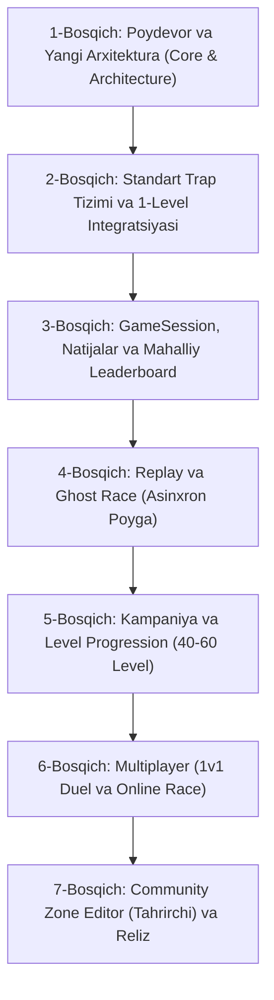

# Wrong Way — Rivojlanish Bosqichlari (Development Roadmap)

Ushbu yo‘l xaritasi loyihaning barcha 12 ta arxitektura va o‘yin qoidalarini bosqichma-bosqich, xatolarsiz va mustahkam asosda amalga oshirish rejasidir.

---

## 📌 Bosqichlar Rejasi

---

### 1-Bosqich: Poydevor va Yangi Arxitektura (Core & Architecture)
**Maqsad:** Loyihani professional standartdagi modulli tuzilmaga o‘tkazish, barcha "God script" lardan voz kechish va qat’iy tiplangan poydevor qurish.

* [ ] **1.1 Papkalar tuzilmasini yaratish:**
  * `scenes/` (`app`, `menu`, `gameplay`, `levels`, `multiplayer`, `editor`, `ui`)
  * `scripts/` (`core`, `gameplay`, `traps`, `systems`, `network`, `editor`, `ui`)
  * `resources/` (`level_data`, `trap_configs`, `themes`, `cosmetics`)
  * `tests/` (`gameplay`, `leaderboard`, `multiplayer`)
  * `assets/` (`art`, `audio`, `fonts`)
* [ ] **1.2 Core tizimlar:**
  * `GameApp`: Global ilova holati, sozlamalar va sahnani xavfsiz yuklash.
  * `GameSession`: Bitta urinishning yagona ishonchli manbai (`start_time`, `elapsed_ms`, `deaths`, `checkpoints`, `is_completed`).
  * `LevelData` (Resource): Level identifikatori, versiyasi (`level_version`), nomi, muallifi va checksum.
* [ ] **1.3 Original PlayerController:**
  * To‘liq tiplangan, hech qanday "magic number" larsiz (`PlayerConfig` resursi orqali tezlik, sakrash balandligi, coyote time sozlanadi).
  * UI yoki serverga bog‘lanmagan, faqat o‘z harakati va o‘limiga javob beruvchi sof controller.
  * O‘ziga xos original "Wrong Way" qahramon vizuali va animatsiyalari.

---

### 2-Bosqich: Standart Trap Tizimi va 1-Level Integratsiyasi
**Maqsad:** Barcha tuzoqlar uchun yagona `TrapBase` interfeysini joriy qilish va 1-darajani yangi arxitektura asosida mukammal qayta yig‘ish.

* [ ] **2.1 `TrapBase` klassi:**
  * Holatlar mashinasi: `IDLE`, `ARMED`, `ACTIVE`, `RESET`.
  * Standart metodlar: `trigger()`, `reset_trap()`, `set_config(config: TrapConfig)`.
  * Visual va audio feedback qatlamini gameplay kodidan ajratish.
* [ ] **2.2 Dastlabki standart tuzoqlar:**
  * `FallingFloorTrap` (Qulab tushuvchi pol tuzog‘i).
  * `SpikeHazard` (Statik va harakatlanuvchi tikanlar).
  * `DropCrusher` (Shiftdan tushuvchi ezgich).
* [ ] **2.3 Yangilangan 1-Level:**
  * Sahnada faqat joylashuv va konfiguratsiyalar saqlanadi (kod sahnaga aralashmaydi).
  * Ishonchli Finish Trigger va zamin tagiga kirib ketuvchi eshik animatsiyasi.

---

### 3-Bosqich: GameSession, Natijalar va Mahalliy Leaderboard
**Maqsad:** Millisekundlik vaqt hisobi, o‘limlar statistikasi va adolatli reyting tizimi.

* [ ] **3.1 `GameSession` logikasi:**
  * Taymer millisekundlarda (`time_ms`).
  * Anti-cheat: Harakat va vaqtning minimal fizik chegaralarini tekshirish.
* [ ] **3.2 `LeaderboardSystem` (Mahalliy):**
  * `Speedrun`: Eng kam vaqt → eng kam o‘lim.
  * `Perfect Run`: 0 o‘lim → eng kam vaqt.
  * `user://leaderboards.json` faylida shifrlangan/checksum bilan saqlash.
* [ ] **3.3 Yangi HUD va Result UI:**
  * Jonli timer (PB bilan solishtirish).
  * Zamonaviy natija oynasi: Vaqt, o‘limlar, yangi rekord nishoni, tezkor qayta o‘ynash (`R`).

---

### 4-Bosqich: Replay va Ghost Race (Asinxron Poyga)
**Maqsad:** Har bir o‘tishni deterministik yozib olish va o‘yinchining shaxsiy rekordi yoki raqibi bilan poygalashishi.

* [ ] **4.1 `ReplaySystem`:**
  * Harakat va sakrash eventlarini kichik hajmli massivda yozib olish (`ReplayData`).
  * Replay faylini tekshirish (natijaning soxta emasligini tasdiqlash).
* [ ] **4.2 Ghost Runner:**
  * Yarim shaffof original sharpacha (Ghost) qahramon bilan birga yugurishi.

---

### 5-Bosqich: Kampaniya va Level Progression (40–60 Level)
**Maqsad:** O‘yinchini bosqichma-bosqich o‘rgatuvchi va murakkablashib boruvchi original darajalar to‘plami.

* [ ] **5.1 Dunyo xaritasi va progress saqlash:**
  * Zonalarni ochish (Level unlock), yulduzlar yoki baholash tizimi.
* [ ] **5.2 Yangi mexanikalar:**
  * Inverted gravity (tortishish kuchining teskarilanishi).
  * Reversing controls ("Wrong Way" konsepti bo‘yicha teskari boshqaruv zonalari).
  * Moving platforms, fake walls va timed puzzles.

---

### 6-Bosqich: Multiplayer (1v1 Duel va Online Race)
**Maqsad:** Do‘stlar va onlayn o‘yinchilar bilan to‘g‘ridan-to‘g‘ri bellashuv.

* [ ] **6.1 1v1 Duel rejimi:**
  * 5 ta raunddan 3 tasini birinchi bo‘lib yutgan g‘olib.
  * Server/Host tomonidan boshqariladigan round timer va checkpoint sync.
* [ ] **6.2 Katta poyga (Online Race):**
  * 2–8 nafar o‘yinchi uchun xona va sinxron start.

---

### 7-Bosqich: Community Zone Editor (Tahrirchi) va Reliz
**Maqsad:** Hamjamiyat o‘z zonalarini yaratishi, o‘zi o‘tib test qilishi va e’lon qilishi.

* [ ] **7.1 Zone Editor vositalari:**
  * Grid bo‘yicha blok, tuzoq, spawn va finish qo‘yish.
* [ ] **7.2 Majburiy test qoidasi:**
  * Muallif o‘z zonasini boshidan oxirigacha o‘tib bermaguncha "Publish" tugmasi faollashmaydi.
* [ ] **7.3 Discover va reyting:**
  * Eng sara zonalar (Trending, Featured, Newest).
